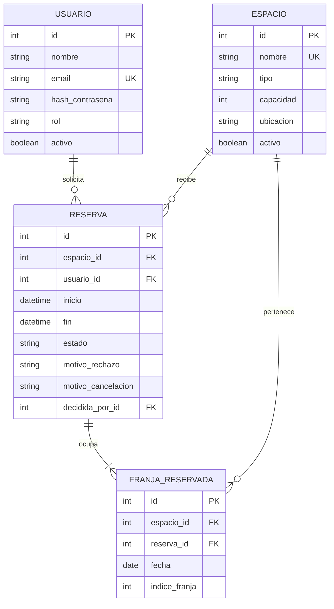
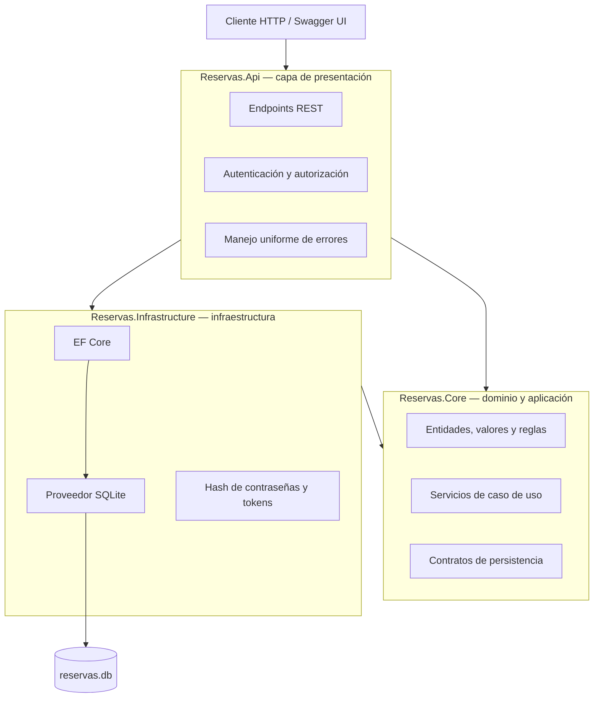
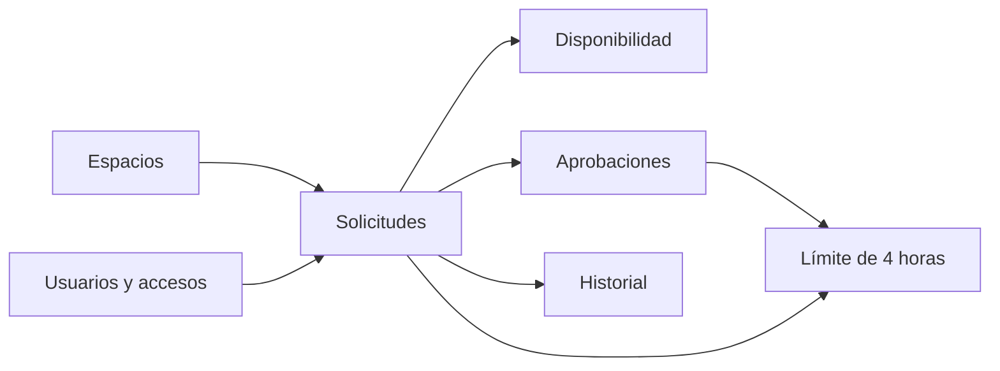

# Plan de Ingeniería de Software

## Sistema de Gestión de Reservas de Espacios Académicos

| Dato | Valor |
|---|---|
| Modalidad | Individual |
| Tema | Planificación de ingeniería, Spec-Driven Development y OpenSpec |
| Estudiante | «completar» |
| Institución | «completar» |
| Fecha | Noviembre de 2026 |
| Versión del documento | 1.0 |

> Este documento se redacta **antes** de inicializar OpenSpec y antes de escribir la primera línea de código. Su propósito es fijar el problema, el alcance, las decisiones técnicas y la estrategia de trabajo que después se convertirán en especificaciones verificables. Cualquier desviación posterior deberá justificarse en el informe final.

---

## 1. Análisis del problema

### 1.1 Situación actual

La institución gestiona hoy las reservas de laboratorios, auditorios y salas de cómputo mediante correos electrónicos y hojas de cálculo compartidas. Este esquema funciona mientras el volumen es bajo, pero no sostiene el crecimiento:

1. **Duplicidad de solicitudes.** Dos personas pueden pedir el mismo espacio para la misma franja sin saberlo, porque no existe un registro único. La hoja de cálculo se copia, se reenvía y se desincroniza.
2. **Conflictos de horario detectados tarde.** El conflicto se descubre cuando las dos partes llegan al espacio, no cuando se solicita. Reagendar implica una nueva cadena de correos.
3. **Disponibilidad opaca.** Para saber si un laboratorio está libre, hay que preguntarle a la persona que administra la hoja. No hay forma de consultar la disponibilidad por cuenta propia.
4. **Aprobaciones sin trazabilidad.** No queda registro de quién autorizó una reserva, cuándo, ni con qué criterio. Tampoco de quién rechazó ni por qué.
5. **Historial inexistente o disperso.** Al terminar el semestre, reconstruir qué espacios se usaron y con qué frecuencia exige revisar correos uno por uno.
6. **Permisos informales.** Cualquiera con acceso a la hoja puede modificar cualquier fila. No hay separación entre quien solicita y quien aprueba.

### 1.2 Necesidades de la institución

| Código | Necesidad | Consecuencia si no se cubre |
|---|---|---|
| N1 | Un registro único de espacios académicos, con tipo y capacidad | No se puede saber qué se está reservando |
| N2 | Un registro único de usuarios con identidad verificable | Cualquiera puede actuar en nombre de otro |
| N3 | Roles diferenciados entre quien solicita y quien autoriza | La aprobación pierde sentido |
| N4 | Solicitudes formales con estado y trazabilidad | No hay a quién responsabilizar |
| N5 | Consulta de disponibilidad por espacio y fecha | El usuario sigue dependiendo del administrador |
| N6 | Garantía de que dos reservas no ocupen la misma franja | Persiste el problema original |
| N7 | Aprobación y rechazo motivados | Decisiones arbitrarias y no auditables |
| N8 | Cancelación con motivo e historial consultable | No se puede reconstruir el uso de los espacios |
| N9 | Una regla institucional posterior: ningún usuario reserva un mismo espacio más de cuatro horas consecutivas | Uso desmedido del espacio y conflictos con la planificación académica |

### 1.3 Actores involucrados

| Actor | Objetivo | Necesita |
|---|---|---|
| **Administrador** | Administrar el catálogo y autorizar el uso de los espacios | Crear y editar espacios y usuarios, ver todas las solicitudes, aprobar, rechazar y cancelar |
| **Docente** | Reservar espacios para clases, laboratorios y evaluaciones | Consultar disponibilidad, solicitar, ver el estado de sus solicitudes, cancelar las propias |
| **Estudiante** | Reservar espacios para trabajos y actividades académicas | Los mismos permisos de solicitud que el docente, sin acceso a la administración |
| **Institución (interesado)** | Conocer el uso de sus espacios y auditar las decisiones | Historial completo y registro de quién aprobó o rechazó cada solicitud |

No se modela un actor "sistema externo": el alcance excluye integraciones.

### 1.4 Alcance y limitaciones

**Dentro del alcance:**

- Catálogo de espacios académicos con tipo, capacidad, ubicación y estado activo/inactivo.
- Registro y administración de usuarios con tres roles.
- Autenticación con credenciales y autorización por rol.
- Solicitudes de reserva con validación de horario y disponibilidad.
- Prevención de solapamientos garantizada por la base de datos, no solo por el código.
- Aprobación y rechazo con motivo y registro del responsable.
- Cancelación con motivo e historial filtrable.
- API REST documentada y pruebas automatizadas.

**Fuera del alcance (declarado explícitamente):**

- Notificaciones por correo electrónico o mensajería.
- Integración con calendarios externos (Google Calendar, Outlook).
- Gestión de varias sedes o zonas horarias.
- Recuperación de contraseña, autenticación federada o doble factor.
- Interfaz web de usuario final: la API se opera desde Swagger UI.
- Reservas recurrentes o periódicas.
- Cobros, penalizaciones o cupos por usuario.
- Aplicación móvil.

**Limitaciones asumidas:**

- Una sola zona horaria institucional. Las horas se interpretan como hora local de la institución.
- El horario de atención es fijo: 07:00 a 22:00, con franjas de 30 minutos.
- La base de datos es un archivo SQLite local, adecuado para el volumen de una institución pequeña y para un entorno académico sin servidor de base de datos.
- Las credenciales de demostración se siembran al arrancar; en producción se desactivarían.

### 1.5 Restricciones del trabajo

- Trabajo individual y con tiempo acotado: el alcance debe ser mínimo pero completo.
- El entorno de desarrollo dispone de .NET 10, Git y OpenSpec, y no dispone de JDK ni de un servidor PostgreSQL.
- La entrega es un repositorio de GitHub cuyo historial debe demostrar la secuencia plan → especificación → implementación → cambio → verificación.

---

## 2. Propuesta de solución

### 2.1 Descripción general

Se propone una **API REST** que centraliza el ciclo de vida completo de una reserva. El usuario se autentica, consulta la disponibilidad real de un espacio, crea una solicitud que queda en estado *Pendiente*, y un administrador la aprueba o la rechaza con un motivo. El sistema impide por construcción que dos reservas activas ocupen la misma franja de un mismo espacio, y conserva el historial de todas las decisiones.

La solución se organiza en **capas** y en **módulos de negocio**, de modo que cada módulo pueda especificarse, implementarse y probarse de forma incremental.

### 2.2 Funcionalidades prioritarias

| Código | Funcionalidad | Prioridad | Justificación |
|---|---|---|---|
| RF01 | Gestionar espacios académicos (crear, consultar, actualizar, desactivar) | Must | Sin catálogo no hay nada que reservar |
| RF02 | Clasificar espacios por tipo y capacidad | Must | Requisito explícito del enunciado |
| RF03 | Registrar y administrar usuarios | Must | Sin usuarios no hay solicitantes identificables |
| RF04 | Asignar roles y aplicar permisos | Must | Separa solicitar de autorizar |
| RF05 | Autenticar y emitir credenciales de sesión | Must | Sostiene los permisos |
| RF06 | Consultar disponibilidad por espacio y fecha | Must | Elimina la dependencia del administrador |
| RF07 | Crear solicitudes de reserva | Must | Núcleo del sistema |
| RF08 | Validar horario institucional y fechas futuras | Must | Evita datos imposibles |
| RF09 | Prevenir reservas simultáneas | Must | Es el problema que motiva el proyecto |
| RF10 | Aprobar o rechazar solicitudes con motivo | Must | Cierra el flujo |
| RF11 | Cancelar reservas con motivo | Must | Requisito explícito |
| RF12 | Consultar historial con filtros | Must | Requisito explícito y auditoría |
| RF13 | Limitar la duración a cuatro horas consecutivas | Must (cambio posterior) | Regla incorporada en la Fase 4 del trabajo |

No se identifican funcionalidades *Could* que entren en el alcance: agregar cualquiera rompería la restricción de alcance mínimo.

### 2.3 Organización del sistema en módulos

| Módulo | Responsabilidad | Depende de |
|---|---|---|
| **Espacios** | Catálogo, tipo, capacidad, activación y desactivación | — |
| **Usuarios y accesos** | Registro, roles, autenticación, autorización | — |
| **Solicitudes** | Alta de reservas, validación de reglas, estados | Espacios, Usuarios |
| **Disponibilidad** | Cálculo de franjas libres y ocupadas | Espacios, Solicitudes |
| **Aprobaciones** | Aprobar y rechazar, registro del responsable | Solicitudes |
| **Historial** | Consulta filtrada y trazabilidad | Solicitudes |

### 2.4 Estrategia para desarrollar el proyecto progresivamente

El trabajo se divide en **tres incrementos**, cada uno con su propio cambio de OpenSpec, sus escenarios de aceptación y sus pruebas:

1. **Incremento 1 — Base administrativa.** Espacios, usuarios, roles y autenticación. Al terminar, un administrador puede preparar el catálogo y las cuentas.
2. **Incremento 2 — Flujo de reservas.** Solicitudes, disponibilidad, prevención de solapamientos, aprobación, rechazo, cancelación e historial. Al terminar, el sistema resuelve el problema original de punta a punta.
3. **Incremento 3 — Regla de las cuatro horas.** Cambio solicitado por la institución. Se especifica, se implementa y se prueba sobre el sistema ya funcionando, sin romper lo anterior.

Cada incremento se cierra con las pruebas en verde, la compilación sin advertencias y el cambio archivado en OpenSpec, de modo que `openspec/specs/` refleje siempre el estado real del sistema.

### 2.5 Modelo conceptual

La entidad `FRANJA_RESERVADA` es la pieza que convierte la prevención de solapamientos en una **garantía de la base de datos**: la combinación `(espacio_id, fecha, indice_franja)` es única, de modo que dos transacciones concurrentes no pueden ocupar la misma franja aunque ambas validen correctamente en memoria.

---

## 3. Decisiones de arquitectura y tecnología

### 3.1 Arquitectura seleccionada y justificación

Se adopta una **arquitectura en capas con un núcleo de dominio aislado**, desplegada como un único proceso:

**Justificación.** La separación permite tres cosas que el trabajo exige: (a) probar las reglas de negocio sin levantar la API; (b) cambiar la base de datos sin tocar el dominio; (c) que la capa de presentación no contenga reglas, lo que hace que la matriz de trazabilidad requisito → prueba sea verificable. Se mantiene **un solo proceso** porque la escala del problema no justifica otra cosa y porque un despliegue distribuido agregaría fallos de red y consistencia que no aportan al objetivo académico.

### 3.2 Stack tecnológico propuesto

| Componente | Tecnología | Motivo |
|---|---|---|
| Lenguaje y runtime | C# sobre .NET 10 | Instalado y verificado en el entorno; tipado estático y buen soporte de pruebas |
| Framework web | ASP.NET Core Minimal API | Menos ceremonia que MVC, endpoints explícitos y fáciles de mapear a los escenarios |
| Acceso a datos | EF Core 10 | Mapeo explícito, migraciones y transacciones |
| Base de datos | SQLite | Archivo único, sin servidor, con restricciones e índices reales |
| Autenticación | JWT HS256 con `Microsoft.AspNetCore.Authentication.JwtBearer` | Estándar, sin estado en el servidor y verificable desde Swagger |
| Hash de contraseñas | PBKDF2 (`Rfc2898DeriveBytes`) | Incluido en la plataforma, sin dependencias externas |
| Documentación de API | Swagger / Swashbuckle | Permite operar el sistema desde el navegador en la sustentación |
| Pruebas | xUnit + `WebApplicationFactory` | Pruebas unitarias y de integración contra la API real |
| Control de versiones | Git | Exigido por la rúbrica; el historial es evidencia del proceso |

**Dependencias externas:** solo paquetes NuGet oficiales o de uso extendido (EF Core, JwtBearer, Swashbuckle, xUnit). No se usan bibliotecas de validación, mapeo ni mediación: el volumen del dominio no las justifica y cada dependencia extra es superficie que hay que justificar.

### 3.3 Estrategia de persistencia

- **Un archivo SQLite** (`reservas.db`) creado por migraciones de EF Core al arrancar.
- **Migraciones versionadas** en `Reservas.Infrastructure/Migraciones`, de modo que el esquema sea reproducible y no dependa de `EnsureCreated`.
- **Transacciones** para toda operación que escriba una reserva y sus franjas: ambas cosas ocurren o no ocurren.
- **Restricciones en la base**: índice único sobre `(espacio_id, fecha, indice_franja)`, clave foránea de reserva a espacio y a usuario, y unicidad de correo y de nombre de espacio.
- **Semilla de desarrollo** idempotente: un administrador, un docente, un estudiante y seis espacios, creada solo si la base está vacía.
- **WAL activado** (`PRAGMA journal_mode=WAL`) para permitir lecturas concurrentes mientras se escribe, y tiempo de espera configurado para los bloqueos de escritura.

### 3.4 Organización de componentes

| Proyecto | Contenido | Regla de dependencia |
|---|---|---|
| `Reservas.Core` | Entidades, enums, reglas de horario, excepciones de negocio, DTO, contratos y servicios de caso de uso | No referencia nada de la solución |
| `Reservas.Infrastructure` | `DbContext`, configuraciones de EF, repositorios, migraciones, hash PBKDF2, emisión de JWT | Referencia `Core` |
| `Reservas.Api` | Endpoints, políticas de autorización, Swagger, composición de dependencias | Referencia `Core` e `Infrastructure` |
| `Reservas.Tests` | Pruebas unitarias de reglas y pruebas de integración de la API | Referencia `Core` e `Infrastructure`, usa `Api` como host |

La regla se verifica por la propia estructura del proyecto: si `Core` necesitara algo de `Infrastructure`, la compilación fallaría por falta de referencia. Es una garantía estructural, no una convención escrita.

### 3.5 Comparación de decisiones técnicas

#### Decisión 1 — Estilo arquitectónico

| Opción | Ventajas | Desventajas | Resultado |
|---|---|---|---|
| **Monolito en capas (elegida)** | Un despliegue, transacciones locales, pruebas simples, separación suficiente | Escala vertical únicamente | **Elegida** |
| Microservicios por módulo | Aislamiento de fallos, escalado independiente | Consistencia distribuida, seis despliegues, trazabilidad más costosa | Descartada: el problema no la justifica |
| Proyecto único sin capas | Menos archivos al inicio | Reglas mezcladas con HTTP, imposible probar sin servidor | Descartada: impide demostrar separación de responsabilidades |

#### Decisión 2 — Plataforma de desarrollo

| Opción | Ventajas | Desventajas | Resultado |
|---|---|---|---|
| **C# / .NET 10 (elegida)** | Runtime ya instalado, EF Core, pruebas integradas, Swagger inmediato | Ecosistema menos común en algunos cursos | **Elegida** |
| Java / Spring Boot | Muy usado en el ámbito académico | El entorno no tiene JDK; instalación y configuración previas | Descartada por costo de entorno |
| Node / Express | Node instalado, arranque rápido | Tipado más débil para reglas de solapamiento, pruebas de integración más frágiles | Descartada por robustez |

#### Decisión 3 — Base de datos

| Opción | Ventajas | Desventajas | Resultado |
|---|---|---|---|
| **SQLite (elegida)** | Sin servidor, archivo versionable, transacciones e índices reales | Un solo escritor a la vez | **Elegida**: el volumen institucional lo tolera |
| PostgreSQL | Concurrencia superior, tipos ricos | Requiere servicio, credenciales y aprovisionamiento | Descartada por infraestructura |
| En memoria | Pruebas rapidísimas | No demuestra persistencia ni restricciones reales; se pierde todo al reiniciar | Descartada: contradice el requisito de confiabilidad |

#### Decisión 4 — Autenticación

| Opción | Ventajas | Desventajas | Resultado |
|---|---|---|---|
| **JWT HS256 (elegida)** | Sin estado, estándar, se prueba desde Swagger, expiración explícita | Revocación inmediata imposible sin lista negra | **Elegida** |
| Sesión en servidor con cookie | Revocación inmediata | Estado en memoria, problemas al escalar, CSRF | Descartada por complejidad añadida |
| HTTP Basic | Trivial de implementar | Credenciales en cada petición, sin expiración ni roles limpios | Descartada por seguridad |

#### Decisión 5 — Prevención de reservas simultáneas

| Opción | Ventajas | Desventajas | Resultado |
|---|---|---|---|
| **Cuadrícula de franjas con índice único (elegida)** | La base impide el solapamiento; funciona ante concurrencia real; consultas de disponibilidad triviales | Exige granularidad fija de 30 minutos | **Elegida** |
| Validar solo en la aplicación | Simple | Dos peticiones simultáneas pueden pasar la validación y ambas escribirse | Descartada: no previene, solo reduce la probabilidad |
| Bloqueo de tabla o `SELECT ... FOR UPDATE` | Correcto en bases con bloqueo de filas | SQLite no ofrece bloqueo de filas; serializa toda la base | Descartada por limitación del motor |

**Consecuencia de la decisión 5:** una reserva debe empezar y terminar en múltiplos de 30 minutos dentro del horario 07:00–22:00. Se asume como regla del negocio y se documenta; no es una limitación accidental.

#### Decisión 6 — Interpretación de "reserva activa"

Se considera **activa** toda reserva en estado *Pendiente* o *Aprobada*. Una solicitud pendiente retiene la franja mientras espera decisión. La alternativa —que solo *Aprobada* bloquee— permitiría acumular solicitudes condenadas a rechazarse y trasladaría al aprobador un conflicto que el sistema ya podía evitar. Se documenta porque afecta directamente los escenarios de aceptación.

### 3.6 Reglas de negocio iniciales

| Código | Regla |
|---|---|
| RN01 | Solo se reserva sobre espacios activos |
| RN02 | Solo usuarios activos pueden autenticarse y solicitar |
| RN03 | La reserva debe estar dentro de 07:00–22:00 del mismo día |
| RN04 | La hora de fin debe ser posterior a la de inicio |
| RN05 | Inicio y fin deben caer en múltiplos de 30 minutos |
| RN06 | La duración mínima es de 30 minutos |
| RN07 | La reserva debe empezar en el futuro |
| RN08 | No puede solaparse con otra reserva activa del mismo espacio |
| RN09 | Solo un Administrador aprueba o rechaza; el rechazo exige motivo |
| RN10 | Solo el dueño o un Administrador cancela; la cancelación exige motivo |
| RN11 | Solo se aprueba o rechaza una reserva Pendiente |
| RN12 | Solo se cancela una reserva Pendiente o Aprobada |

La regla de las cuatro horas **no** forma parte de este conjunto inicial: se incorpora en la Fase 4 como cambio gestionado, con su propia actualización de especificaciones.

---

## 4. Estrategia de desarrollo

### 4.1 Metodología de trabajo

Se trabaja con **Spec-Driven Development sobre OpenSpec**, en ciclos cortos. Cada ciclo sigue siempre el mismo orden:

1. **Propuesta** (`proposal.md`): qué cambia y por qué.
2. **Especificación** (`specs/<capacidad>/spec.md`): requisitos con escenarios verificables.
3. **Diseño** (`design.md`): decisiones del incremento y alternativas descartadas.
4. **Tareas** (`tasks.md`): descomposición verificable.
5. **Revisión de la especificación**: consistencia, ambigüedades, correspondencia con este plan y definición de tareas.
6. **Implementación**: solo de lo especificado y revisado.
7. **Pruebas**: unitarias e integración.
8. **Archivo del cambio**: el delta pasa a `openspec/specs/`.

**Ninguna funcionalidad se implementa antes de que su especificación esté revisada.** El historial de Git refleja ese orden en commits separados, porque la rúbrica lo exige y porque es la única forma de demostrarlo.

Convención de commits: `tipo(alcance): descripción` en imperativo, con tipos `docs`, `chore`, `feat`, `test` y `fix`.

### 4.2 Etapas de implementación

| Etapa | Contenido | Entregable | Criterio de término |
|---|---|---|---|
| **E0** | Plan de ingeniería | `PLAN_INGENIERIA.md` | Documento completo, commit propio y aislado |
| **E1** | Especificación del incremento 1 | Cambio OpenSpec de espacios y usuarios | `openspec validate --strict` en verde y revisión documentada |
| **E2** | Implementación del incremento 1 | API de espacios, usuarios y autenticación | Compila sin advertencias, pruebas en verde, cambio archivado |
| **E3** | Especificación del incremento 2 | Cambio OpenSpec de reservas | Validación estricta y escenarios de concurrencia definidos |
| **E4** | Implementación del incremento 2 | Flujo completo de reservas | Pruebas en verde, Swagger operativo, cambio archivado |
| **E5** | Cambio de las cuatro horas | Cambio OpenSpec y su implementación | Especificación actualizada antes del código, pruebas nuevas y antiguas en verde |
| **E6** | Cierre | README, informe final, verificación de trazabilidad | Todos los requisitos con escenario y prueba; historial limpio |

### 4.3 Orden de desarrollo de funcionalidades

1. **RF01–RF02** Espacios (sin espacios no hay reservas).
2. **RF03–RF05** Usuarios, roles y autenticación (sin identidad no hay permisos).
3. **RF06, RF08** Disponibilidad y validaciones de horario (base del alta).
4. **RF07, RF09** Solicitudes y prevención de solapamientos (núcleo).
5. **RF10** Aprobación y rechazo.
6. **RF11–RF12** Cancelación e historial.
7. **RF13** Límite de cuatro horas (cambio).

El orden no es arbitrario: cada funcionalidad solo depende de las anteriores. La prevención de solapamientos se implementa junto con el alta porque separarlas obligaría a escribir dos veces la validación.

### 4.4 Dependencias entre componentes

Una dependencia mal direccionada se detecta en compilación: `Core` no puede depender de `Api` porque el proyecto no la referencia.

### 4.5 Criterios para considerar terminada cada etapa

Se considera terminada una etapa solo si se cumplen **todos** estos criterios:

1. La especificación del incremento está validada con `openspec validate --strict`.
2. La compilación produce **0 errores y 0 advertencias**.
3. Todas las pruebas pasan y ninguna queda omitida.
4. Cada escenario de aceptación tiene al menos una prueba que lo ejercita.
5. Los endpoints nuevos aparecen en Swagger con ejemplo de petición y respuesta.
6. El cambio está archivado y `openspec/specs/` refleja el estado real.
7. El commit correspondiente existe y su mensaje describe el incremento.

---

## 5. Estrategia de calidad

### 5.1 Tipos de pruebas

| Tipo | Qué verifica | Herramienta | Ejemplo |
|---|---|---|---|
| **Unitaria de reglas** | Cálculo de franjas, límites de horario, redondeo, duración | xUnit | Una reserva de 07:00 a 07:30 ocupa exactamente una franja |
| **Integración de API** | Contrato HTTP, autenticación, permisos, validaciones, persistencia | xUnit + `WebApplicationFactory` + SQLite temporal | Un docente no puede crear un espacio: 403 |
| **Integración de flujo** | Secuencia completa solicitud → aprobación → cancelación | Ídem | El estado final y el historial son coherentes |
| **Concurrencia** | Que la restricción de base impida la doble reserva | Peticiones paralelas reales | Diez altas simultáneas sobre la misma franja: exactamente una responde 201 |
| **Regresión** | Que el cambio de las cuatro horas no rompa lo anterior | Suite completa | Las pruebas del incremento 2 siguen pasando tras el cambio |
| **Exploratoria manual** | Usabilidad de la API y mensajes de error | Swagger UI | El mensaje de rechazo explica el motivo exacto |

**Criterio de suficiencia:** no se persigue cobertura porcentual. Se exige que **cada escenario de aceptación** de las especificaciones tenga una prueba que lo ejerza y que los caminos de error importantes (401, 403, 404, 409, 400) estén cubiertos.

### 5.2 Riesgos identificados

| Código | Riesgo | Prob. | Impacto | Mitigación | Plan de contingencia |
|---|---|---|---|---|---|
| R1 | Ambigüedad en "reserva simultánea": ¿bloquea una solicitud pendiente? | Alta | Alto | Decisión explícita (RN de la sección 3.5) y escenario de aceptación que la fija | Si el docente interpreta lo contrario, se cambia la especificación y se ajusta una sola condición |
| R2 | Condición de carrera en altas concurrentes | Media | Alto | Índice único en la base + prueba de concurrencia con diez peticiones | Si SQLite bloquea, se configura WAL y tiempo de espera; se documenta |
| R3 | El cambio de las cuatro horas se implementa sin actualizar la especificación | Media | Alto | Orden obligatorio del ciclo y commit de especificación previo al de código | Revertir el commit de código y repetir el ciclo |
| R4 | La IA genera código que no corresponde a la especificación | Alta | Alto | Revisión contra escenarios, pruebas que fallan si no se cumple, diff revisado | Se descarta el código generado y se reescribe desde la especificación |
| R5 | Pérdida o desorden del historial de Git | Baja | Crítico | Commits pequeños y en el orden del ciclo; el plan va en un commit aislado | Reconstruir la secuencia con `git rebase` no es aceptable: se documenta el incidente |
| R6 | Bloqueos de SQLite bajo escritura concurrente | Media | Medio | WAL, tiempo de espera, transacciones cortas | Migrar a PostgreSQL queda documentado como trabajo futuro |
| R7 | Credenciales o tokens expuestos en el repositorio | Media | Alto | Claves solo en configuración de desarrollo, contraseñas con PBKDF2, `.gitignore` para la base | Rotar la clave y limpiar el historial si ocurre |
| R8 | Crecimiento del alcance por funcionalidades atractivas | Alta | Medio | Lista explícita de "fuera del alcance" en la sección 1.4 | Rechazar la funcionalidad y registrarla como trabajo futuro |
| R9 | Dependencia de paquetes con cambios incompatibles | Baja | Medio | Versiones fijadas; compilación y pruebas en cada etapa | Ajustar versión y registrar la decisión |

### 5.3 Mecanismos para verificar el cumplimiento de requisitos

1. **Matriz de trazabilidad** mantenida en el informe final: cada RF apunta a su capacidad, su escenario, su endpoint y su prueba.
2. **Pruebas que citan el escenario** en el nombre o en un comentario, para que la correspondencia sea legible.
3. **Validación estricta de OpenSpec** en cada cambio.
4. **Revisión de la especificación antes de implementar**, con lista de verificación: ¿es verificable?, ¿es consistente con el plan?, ¿tiene escenarios de error?, ¿hay ambigüedad?
5. **Revisión de la implementación contra la especificación**, endpoint por endpoint.
6. **Verificación manual en Swagger** de cada flujo antes de cerrar la etapa.

### 5.4 Criterios de aceptación globales

- **CA01** Un administrador crea un espacio y queda disponible para reservar.
- **CA02** Un usuario no autenticado recibe 401 en cualquier endpoint protegido.
- **CA03** Un docente recibe 403 al intentar administrar espacios o usuarios.
- **CA04** Un docente consulta la disponibilidad de un espacio en una fecha y obtiene franjas libres y ocupadas.
- **CA05** Un docente crea una solicitud válida y queda en estado Pendiente.
- **CA06** Una solicitud fuera del horario, en el pasado o desalineada se rechaza con 400 y un mensaje explicativo.
- **CA07** Dos solicitudes activas sobre la misma franja y espacio no pueden coexistir: la segunda recibe 409.
- **CA08** Diez altas simultáneas sobre la misma franja producen exactamente un 201.
- **CA09** Un administrador aprueba una solicitud pendiente y el estado cambia a Aprobada con registro del responsable.
- **CA10** Un rechazo sin motivo se rechaza con 400.
- **CA11** El dueño cancela su reserva con motivo y el estado cambia a Cancelada.
- **CA12** Un usuario no puede cancelar la reserva de otro: 403.
- **CA13** El historial se filtra por estado, espacio y rango de fechas.
- **CA14** Una reserva de más de cuatro horas se rechaza con 400 tras el cambio.
- **CA15** Dos reservas contiguas del mismo usuario y espacio que suman más de cuatro horas se rechazan tras el cambio.
- **CA16** La suite completa pasa tras el cambio, incluidas las pruebas anteriores.

---

## 6. Uso de SDD e inteligencia artificial

### 6.1 Cómo se utilizará OpenSpec

OpenSpec se inicializa **después** de este documento. Cada incremento se gestiona como un *cambio* con cuatro artefactos:

| Artefacto | Función | Criterio de calidad |
|---|---|---|
| `proposal.md` | Explica el qué y el porqué, el alcance y el impacto | Debe permitir decidir si el cambio se acepta |
| `specs/<capacidad>/spec.md` | Requisitos con escenarios `WHEN`/`THEN` | Cada escenario debe ser observable desde fuera |
| `design.md` | Decisiones del incremento y alternativas | Debe decir qué se descartó y por qué |
| `tasks.md` | Descomposición en tareas verificables | Cada tarea con su forma de comprobación |

Flujo de comandos previsto: `openspec new change`, redacción de artefactos, `openspec validate --strict`, implementación, `openspec archive`.

La validación estricta es un filtro real: un escenario sin `WHEN`/`THEN`, una capacidad mal referenciada o un delta incompatible hacen fallar el comando. Eso convierte la especificación en un artefacto verificable por herramienta, no en prosa.

### 6.2 Cómo se transformará el plan en especificaciones

| Sección de este plan | Artefacto OpenSpec |
|---|---|
| 1.2 Necesidades y 2.2 RF | Requisitos de las capacidades |
| 2.3 Módulos | Capacidades (`espacios-academicos`, `usuarios-y-permisos`, `solicitudes-de-reserva`, `aprobacion-de-reservas`, `cancelacion-e-historial`) |
| 3.5 Decisiones | Secciones de `design.md` |
| 3.6 Reglas de negocio | Requisitos y escenarios de rechazo |
| 5.4 Criterios de aceptación | Escenarios de aceptación |
| 2.4 Incrementos | Un cambio por incremento |

La transformación no es automática: exige convertir necesidades en comportamientos observables. Por ejemplo, "N6: garantía de que dos reservas no ocupen la misma franja" se convierte en dos escenarios distintos —uno de validación previa y otro de concurrencia real— porque son comportamientos diferentes y fallan por causas diferentes.

### 6.3 Actividades delegadas a la IA

Se delega, con revisión posterior:

- Generación del andamiaje de proyectos, archivos de configuración y referencias.
- Redacción de borradores de código a partir de la especificación ya aprobada.
- Redacción de borradores de pruebas a partir de los escenarios.
- Redacción de documentación de uso (README) y de borradores del informe.
- Detección de inconsistencias entre especificación y código.

### 6.4 Cómo se verificará el código generado

1. **Compilación sin advertencias** en cada etapa.
2. **Ejecución de la suite completa**, no solo de las pruebas nuevas.
3. **Revisión de cada endpoint contra su escenario**, incluyendo códigos de estado y mensajes.
4. **Prueba manual en Swagger** de los flujos completos.
5. **Revisión del diff** antes de cada commit, para descartar código no solicitado.
6. **Prueba de concurrencia** ejecutada de verdad, no supuesta.
7. **Verificación de que la base impide el solapamiento** con una prueba que ataque directamente la restricción.

Una prueba que pasa no demuestra que el código sea correcto: demuestra que cumple lo que la prueba afirma. Por eso la revisión va contra la especificación y no contra la prueba.

### 6.5 Decisiones que retiene el estudiante

No se delegan:

- La definición del alcance y lo que queda fuera.
- La interpretación de las reglas ambiguas (por ejemplo, si una solicitud pendiente bloquea la franja).
- La elección de arquitectura, base de datos y mecanismo de autenticación.
- La redacción final de los requisitos y de los escenarios de aceptación.
- La decisión de aceptar o rechazar un incremento.
- La verificación de que el código corresponde a la especificación.
- La aprobación del commit y del mensaje que lo describe.

La IA acelera la producción; la responsabilidad técnica, la interpretación del negocio y la aceptación del resultado son del estudiante. Si el código contradice la especificación, se corrige el código o se cambia la especificación mediante el proceso, nunca se ajusta la prueba para que pase.

### 6.6 Limitaciones del enfoque

- OpenSpec verifica la **forma** de la especificación, no su **calidad**: una especificación puede ser válida y ambigua a la vez. La revisión humana sigue siendo imprescindible.
- El historial de Git demuestra el orden de los commits, no la intención. La correspondencia se refuerza con mensajes descriptivos y con el informe final.
- La IA puede producir código plausible y equivocado. El mecanismo de control es la prueba derivada del escenario, no la confianza en el modelo.
- El cambio de las cuatro horas se conocerá desde el inicio de este plan; el ejercicio consiste en gestionarlo **como si no se conociera**, manteniendo la disciplina de especificar antes de implementar. Se declara aquí para que la evaluación del proceso sea honesta.

---

## 7. Resultado esperado

Un repositorio que permita reconstruir la historia completa del proyecto: qué se planificó, qué se especificó, en qué orden se implementó, cómo se verificó y qué cambió respecto de la planificación inicial. El sistema debe resolver el problema de las reservas duplicadas con una garantía técnica verificable, y el proceso debe poder defenderse sin depender de la memoria de quien lo construyó.
