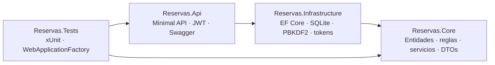
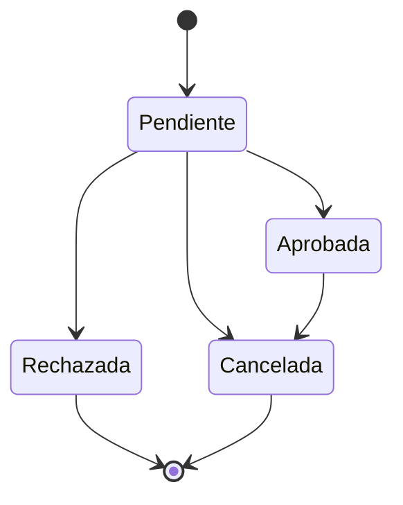

# Sistema de Reservas de Espacios Académicos

API REST para gestionar la reserva de laboratorios, auditorios y salas de cómputo de una institución educativa. Permite administrar el catálogo de espacios, registrar usuarios con roles, crear solicitudes de reserva, aprobarlas o rechazarlas, cancelarlas y consultar la disponibilidad y el historial.

El proyecto se desarrolló con **desarrollo guiado por especificaciones (SDD)** usando [OpenSpec](https://github.com/Fission-AI/OpenSpec). El plan de ingeniería se escribió y se registró **antes** de las especificaciones, y cada especificación se registró **antes** de su implementación. El historial de Git conserva ese orden.

- [`PLAN_INGENIERIA.md`](PLAN_INGENIERIA.md): problemática, alcance, arquitectura, decisiones comparadas, riesgos y metodología.
- [`INFORME_FINAL.md`](INFORME_FINAL.md): proceso, evidencia de la secuencia plan → specs → código, matriz de trazabilidad, resultados de las pruebas y análisis del cambio funcional.
- [`openspec/`](openspec/): especificaciones vigentes y cambios archivados.

---

## Tabla de contenido

1. [Funcionalidades](#1-funcionalidades)
2. [Arquitectura](#2-arquitectura)
3. [Requisitos](#3-requisitos)
4. [Puesta en marcha](#4-puesta-en-marcha)
5. [Endpoints](#5-endpoints)
6. [Reglas de negocio](#6-reglas-de-negocio)
7. [Pruebas](#7-pruebas)
8. [Estructura del repositorio](#8-estructura-del-repositorio)
9. [Proceso SDD con OpenSpec](#9-proceso-sdd-con-openspec)
10. [Decisiones técnicas](#10-decisiones-técnicas)
11. [Limitaciones conocidas](#11-limitaciones-conocidas)
12. [Estado del proyecto](#12-estado-del-proyecto)

---

## 1. Funcionalidades

| # | Funcionalidad | Descripción |
|---|---|---|
| 1 | Catálogo de espacios | Alta, consulta, edición y desactivación lógica de laboratorios, auditorios y salas de cómputo. |
| 2 | Usuarios | Registro y administración de usuarios con nombre, correo único y contraseña protegida. |
| 3 | Roles y permisos | Administrador, Docente y Estudiante, con políticas de autorización por endpoint. |
| 4 | Solicitudes de reserva | Docentes y estudiantes solicitan un espacio en una fecha y un horario válidos. |
| 5 | Disponibilidad | Consulta de las 30 franjas de 30 minutos de un espacio en una fecha. |
| 6 | Prevención de simultáneas | Dos reservas activas no pueden ocupar la misma franja, ni siquiera con peticiones concurrentes. |
| 7 | Aprobación y rechazo | El Administrador aprueba o rechaza solicitudes; el rechazo exige motivo. |
| 8 | Cancelación e historial | El dueño o el Administrador cancela con motivo; cada usuario ve su historial y el Administrador ve el global. |
| 9 | Límite de cuatro horas | Ningún usuario puede reservar un mismo espacio durante más de cuatro horas consecutivas, incluso repartidas en varias solicitudes contiguas. |

---

## 2. Arquitectura

Monolito en capas con cuatro proyectos y dependencias unidireccionales:



| Proyecto | Responsabilidad | Depende de |
|---|---|---|
| `Reservas.Core` | Dominio rico, reglas de negocio, máquina de estados, DTOs, interfaces de repositorio y servicios de aplicación. No conoce ASP.NET Core ni EF Core. | — |
| `Reservas.Infrastructure` | Persistencia con EF Core y SQLite, repositorios, unidad de trabajo, migraciones, semilla, hash PBKDF2, emisión de JWT y reloj del sistema. | `Reservas.Core` |
| `Reservas.Api` | Endpoints minimal API, autenticación y autorización, manejo uniforme de errores, Swagger y composición de dependencias. | `Reservas.Infrastructure`, `Reservas.Core` |
| `Reservas.Tests` | Pruebas unitarias e integración de extremo a extremo con base SQLite temporal por prueba. | `Reservas.Api`, `Reservas.Core` |

### Modelo de datos

| Entidad | Campos principales | Restricciones |
|---|---|---|
| `Espacio` | `Id`, `Nombre`, `Tipo`, `Capacidad`, `Ubicacion`, `Activo` | Nombre único sin distinguir mayúsculas (`NOCASE`). |
| `Usuario` | `Id`, `Nombre`, `Email`, `HashContrasena`, `Rol`, `Activo`, `CreadoEn` | Email único sin distinguir mayúsculas. |
| `Reserva` | `Id`, `EspacioId`, `UsuarioId`, `Inicio`, `Fin`, `Estado`, motivos, marcas de decisión y cancelación | Claves foráneas con borrado restringido; índices por `(EspacioId, Inicio)` y `(UsuarioId, Inicio)`. |
| `FranjaReservada` | `Id`, `ReservaId`, `EspacioId`, `Fecha`, `Indice` | Índice único `IX_franjas_reservadas_unicas` sobre `(EspacioId, Fecha, Indice)`. |

Cada reserva se descompone en franjas de 30 minutos. El índice único es la garantía de exclusión mutua a nivel de base de datos: aunque dos peticiones simultáneas superen la validación previa, solo una puede insertar la misma franja.

### Máquina de estados



`Pendiente` y `Aprobada` son estados activos: ocupan franjas. `Rechazada` y `Cancelada` liberan las franjas y no cuentan para el límite de cuatro horas.

---

## 3. Requisitos

- [.NET SDK 10](https://dotnet.microsoft.com/download) (el proyecto apunta a `net10.0`).
- Windows, Linux o macOS.
- Opcional: [OpenSpec CLI](https://github.com/Fission-AI/OpenSpec) 1.13 o superior para inspeccionar o validar las especificaciones.

No hace falta instalar SQLite: el proveedor `Microsoft.Data.Sqlite` incluye el motor y la base se crea como archivo local.

---

## 4. Puesta en marcha

```powershell
# 1. Restaurar dependencias
dotnet restore

# 2. Ejecutar la API (perfil http, puerto 5080)
dotnet run --project src/Reservas.Api
```

Abrir <http://localhost:5080/swagger>. La raíz `/` redirige a Swagger.

En el primer arranque, un servicio de inicio aplica las migraciones y, si la base está vacía y el entorno es `Development`, siembra usuarios y espacios de demostración. La base se guarda como `reservas.db` en el directorio del proyecto de la API.

### 4.1 Usuarios de demostración

| Rol | Correo | Contraseña |
|---|---|---|
| Administrador | `admin@universidad.edu` | `Admin123!` |
| Docente | `docente@universidad.edu` | `Docente123!` |
| Estudiante | `estudiante@universidad.edu` | `Estudiante123!` |

> Credenciales exclusivamente de desarrollo. En un despliegue real deben cambiarse y la clave JWT debe provenir de un gestor de secretos.

Espacios sembrados: Laboratorio de Redes, Laboratorio de Física, Auditorio Principal, Sala de Cómputo 1, Sala de Cómputo 2 y Sala de Cómputo 3.

### 4.2 Reiniciar la base de datos

Detener la API y eliminar `src/Reservas.Api/reservas.db` (junto con `reservas.db-wal` y `reservas.db-shm` si existen). El siguiente arranque vuelve a migrar y sembrar.

### 4.3 Flujo mínimo con Swagger

1. `POST /api/auth/login` con el docente; copiar el `token`.
2. Pulsar **Authorize** y escribir `Bearer {token}` (o solo el token, según la versión de Swagger UI).
3. `GET /api/espacios` para obtener un `id`.
4. `POST /api/reservas` con `espacioId`, `inicio` y `fin` en ISO 8601 (`AAAA-MM-DDTHH:mm:ss`), usando una fecha futura.
5. Iniciar sesión como administrador y `POST /api/reservas/{id}/aprobar`.
6. `GET /api/disponibilidad?espacioId=1&fecha=AAAA-MM-DD` con la misma fecha.

---

## 5. Endpoints

Todos los endpoints salvo el inicio de sesión exigen un token JWT válido. La política de respaldo exige autenticación cuando un endpoint no declara una política explícita.

| Método | Ruta | Rol | Descripción |
|---|---|---|---|
| `POST` | `/api/auth/login` | Anónimo | Inicia sesión y devuelve un JWT de 8 horas. |
| `GET` | `/api/auth/perfil` | Autenticado | Devuelve el perfil del usuario autenticado. |
| `GET` | `/api/espacios` | Autenticado | Lista espacios; filtros `tipo` y `activo`. |
| `GET` | `/api/espacios/{id}` | Autenticado | Consulta un espacio. |
| `POST` | `/api/espacios` | Administrador | Registra un espacio. |
| `PUT` | `/api/espacios/{id}` | Administrador | Actualiza un espacio. |
| `DELETE` | `/api/espacios/{id}` | Administrador | Desactiva lógicamente el espacio. |
| `GET` | `/api/usuarios` | Administrador | Lista usuarios. |
| `POST` | `/api/usuarios` | Administrador | Registra un usuario. |
| `PUT` | `/api/usuarios/{id}` | Administrador | Actualiza nombre, rol y estado. |
| `POST` | `/api/usuarios/{id}/contrasena` | Administrador | Restablece la contraseña. |
| `POST` | `/api/reservas` | Docente, Estudiante | Crea una solicitud en estado `Pendiente`. |
| `GET` | `/api/reservas/mias` | Autenticado | Historial propio; filtros `estado`, `espacioId`, `desde`, `hasta`. |
| `GET` | `/api/reservas` | Administrador | Historial global con los mismos filtros. |
| `GET` | `/api/reservas/{id}` | Dueño, Administrador | Detalle de una reserva. |
| `POST` | `/api/reservas/{id}/aprobar` | Administrador | Aprueba una solicitud pendiente. |
| `POST` | `/api/reservas/{id}/rechazar` | Administrador | Rechaza con motivo obligatorio. |
| `POST` | `/api/reservas/{id}/cancelar` | Dueño, Administrador | Cancela con motivo obligatorio. |
| `GET` | `/api/disponibilidad` | Autenticado | Franjas de un espacio en una fecha (`espacioId`, `fecha`). |

### Errores uniformes

Todas las respuestas de error usan `ProblemDetails` (`application/problem+json`):

| Código | Situación |
|---|---|
| `400` | Regla de negocio incumplida: horario, alineación, duración, límite de cuatro horas, transición de estado inválida, motivo faltante, JSON malformado o valor de enum desconocido. |
| `401` | Token ausente, inválido o expirado; usuario desactivado. |
| `403` | Rol insuficiente o recurso ajeno. |
| `404` | Recurso inexistente. |
| `409` | Solapamiento de franjas, nombre de espacio duplicado o correo duplicado. |
| `500` | Error no controlado, sin exponer detalles internos. |

---

## 6. Reglas de negocio

### Horario y franjas

- Horario institucional de **07:00 a 22:00**, todos los días.
- Franjas de **30 minutos**: 30 franjas por día.
- La reserva debe empezar y terminar el mismo día, en múltiplos de 30 minutos, durar al menos 30 minutos y comenzar en el futuro.
- La hora es la del servidor, en una única zona horaria (decisión documentada como limitación).

### Solicitudes y estados

- Solo Docentes y Estudiantes crean solicitudes; el Administrador no, para evitar la autoaprobación.
- Toda solicitud nace en `Pendiente` y queda asociada al usuario autenticado, no a un identificador enviado por el cliente.
- El Administrador aprueba o rechaza; el rechazo exige un motivo no vacío.
- El dueño o el Administrador cancela; la cancelación exige motivo y solo aplica a reservas activas.
- Una reserva `Pendiente` ya bloquea la franja. Rechazar o cancelar libera las franjas.

### Prevención de reservas simultáneas

- Se rechaza cualquier solapamiento con una reserva activa del mismo espacio, incluso si la nueva reserva rodea a la existente.
- La validación en la aplicación da un mensaje claro; el índice único de `franjas_reservadas` impide la doble inserción si dos peticiones compiten.
- La violación del índice se traduce a `409 Conflict`, no a un error 500.

### Límite de cuatro horas consecutivas

La regla de la fase 4 se interpretó y se implementó en dos niveles:

1. **Por solicitud:** una reserva individual no puede superar las cuatro horas.
2. **Por acumulación:** se calcula el bloque continuo de reservas activas del mismo usuario en el mismo espacio que toca o solapa la nueva solicitud. Si el bloque supera las cuatro horas, se rechaza.

Detalles:

- Dos reservas son consecutivas cuando el fin de una coincide con el inicio de la otra o se superpone con ella.
- Un intervalo libre de cualquier duración corta la cadena y reinicia el conteo.
- Solo cuentan las reservas `Pendiente` y `Aprobada`; las rechazadas y canceladas no.
- Las reservas de otros usuarios y de otros espacios no se suman.
- Exactamente cuatro horas es válido; el límite es "más de cuatro".
- No hay migración de datos: la regla se evalúa al crear solicitudes nuevas.

### Seguridad

- Contraseñas con **PBKDF2-HMAC-SHA256**, 120 000 iteraciones, sal aleatoria de 16 bytes y formato `pbkdf2-sha256$iteraciones$sal$hash`.
- JWT **HS256** con emisor, audiencia, expiración de 8 horas y tolerancia de reloj de 30 segundos.
- Un middleware relee el usuario en cada petición: si fue desactivado o eliminado, el token deja de servir aunque no haya expirado.
- El hash y el estado nunca se devuelven en las respuestas.

---

## 7. Pruebas

```powershell
dotnet test
```

La suite tiene **108 pruebas**:

| Archivo | Cantidad | Qué cubre |
|---|---:|---|
| `ReglasDeReservaTests` | 20 | Franjas, alineación, horario, duración, límite de cuatro horas y algoritmo de bloques. |
| `ReservasTests` | 13 | Creación, permisos, validaciones, solapamientos y espacios desactivados. |
| `AprobacionTests` | 10 | Aprobación, rechazo con motivo, transiciones y liberación de franjas. |
| `CancelacionTests` | 7 | Cancelación propia y administrativa, motivos y liberación. |
| `HistorialTests` | 9 | Historial propio y global, filtros, detalle y orden. |
| `DisponibilidadTests` | 5 | 30 franjas, ocupación, pasado, espacio inexistente y privacidad. |
| `LimiteCuatroHorasTests` | 10 | Duración máxima, acumulación, huecos, usuario, espacio y estados. |
| `ConcurrenciaTests` | 1 | Diez peticiones simultáneas: exactamente una reserva y nueve conflictos. |
| `EspaciosTests` | 12 | CRUD, validaciones, duplicados y desactivación con historial. |
| `UsuariosTests` | 8 | Registro, roles, duplicados y estado. |
| `AutenticacionTests` | 8 | Login, token, perfil, credenciales inválidas y usuario desactivado. |
| `HashPbkdf2Tests` | 5 | Formato, sal, verificación y resistencia a cambios. |

Las pruebas de integración usan `WebApplicationFactory<Program>` con una base SQLite temporal por prueba, configuración inyectada y clientes autenticados por rol. No comparten estado entre sí y pueden ejecutarse en paralelo.

---

## 8. Estructura del repositorio

```text
.
├── PLAN_INGENIERIA.md            # Etapa 1: plan previo a todo
├── INFORME_FINAL.md              # Informe de cierre
├── README.md
├── Directory.Build.props         # net10.0, nullable, advertencias como errores
├── ReservasAcademicas.slnx
├── dotnet-tools.json             # dotnet-ef 10.0.15
├── openspec/
│   ├── config.yaml               # schema spec-driven, español
│   ├── specs/                    # 5 capacidades vigentes
│   │   ├── espacios-academicos/
│   │   ├── usuarios-y-permisos/
│   │   ├── solicitudes-de-reserva/
│   │   ├── aprobacion-de-reservas/
│   │   └── cancelacion-e-historial/
│   └── changes/archive/          # 3 cambios archivados
└── src/
    ├── Reservas.Api/
    │   ├── Endpoints/
    │   ├── Errores/
    │   ├── Inicio/
    │   ├── Seguridad/
    │   └── Program.cs
    ├── Reservas.Core/
    │   ├── Abstractions/
    │   ├── Domain/
    │   ├── Dtos/
    │   └── Servicios/
    ├── Reservas.Infrastructure/
    │   ├── Persistencia/
    │   │   └── Migraciones/
    │   ├── Seguridad/
    │   └── Tiempo/
    └── Reservas.Tests/
        ├── Infraestructura/
        └── Pruebas/
```

---

## 9. Proceso SDD con OpenSpec

OpenSpec se inicializó con el esquema `spec-driven` y respuestas en español:

```powershell
$env:OPENSPEC_TELEMETRY='0'
openspec init --tools opencode --language spanish
```

Cada incremento siguió el mismo ciclo:

1. **Propuesta** (`proposal.md`): por qué, qué cambia y qué capacidades se afectan.
2. **Diseño** (`design.md`): contexto, decisiones, alternativas descartadas e impacto.
3. **Tareas** (`tasks.md`): pasos verificables.
4. **Delta de especificación** (`specs/<capacidad>/spec.md`): requisitos `SHALL` y escenarios `WHEN`/`THEN`.
5. **Validación estricta** antes de programar:

   ```powershell
   openspec validate <cambio> --type change --strict
   ```

6. **Implementación y pruebas** contra los escenarios.
7. **Archivo** del cambio, que actualiza `openspec/specs/`:

   ```powershell
   openspec archive <cambio> --yes
   openspec validate --all --strict
   ```

Cambios realizados:

| Cambio | Alcance | Estado |
|---|---|---|
| `agregar-gestion-espacios-usuarios` | Espacios, usuarios, roles, autenticación | Archivado |
| `agregar-flujo-reservas` | Solicitudes, disponibilidad, simultaneidad, aprobación, cancelación e historial | Archivado |
| `agregar-limite-cuatro-horas` | Regla de la fase 4 | Archivado |

Cada cambio tiene su commit de especificación **anterior** al commit de implementación. La evidencia completa está en el [`INFORME_FINAL.md`](INFORME_FINAL.md).

---

## 10. Decisiones técnicas

El plan compara las alternativas con más detalle. Resumen:

| # | Decisión | Alternativa descartada | Motivo |
|---|---|---|---|
| 1 | API REST documentada con Swagger UI | Panel web MVC o Blazor | Concentra el esfuerzo en el dominio y deja un contrato verificable y consumible por cualquier cliente. |
| 2 | EF Core con SQLite | Dapper con SQL manual; PostgreSQL | Migraciones, consultas tipadas y cero configuración local. El índice único de SQLite cubre la garantía de concurrencia; PostgreSQL queda como ruta de producción. |
| 3 | Franjas de 30 minutos con índice único | Validar solo con una consulta de solapamiento | La consulta previa es vulnerable a carreras; el índice hace cumplir la regla en la base. |
| 4 | La reserva `Pendiente` bloquea la franja | Bloquear solo las aprobadas | Evita que dos solicitudes pendientes se aprueben sobre la misma franja; rechazar o cancelar libera. |
| 5 | JWT más middleware que relee el usuario | Sesión en servidor; JWT sin consulta a la base | Mantiene el token sin estado y permite revocar de inmediato a un usuario desactivado. |
| 6 | PBKDF2 integrado en .NET | BCrypt; ASP.NET Core Identity | Sin dependencias adicionales, formato explícito, parametrizable y fácil de probar. |
| 7 | Minimal API | Controladores MVC | Menos ceremonia para el tamaño del proyecto; las políticas y los filtros cubren autorización y errores. |
| 8 | Monolito en capas | Microservicios | El problema y el plazo no justifican la complejidad operativa; las fronteras entre capas permiten separar después. |
| 9 | Regla de cuatro horas por solicitud y por cadena | Limitar solo la solicitud individual | La segunda lectura es evitable creando dos reservas contiguas; el enunciado habla de "durante más de cuatro horas consecutivas". |
| 10 | Límite por usuario y espacio | Límite global por usuario | El enunciado dice "un espacio académico"; un límite global sería más restrictivo que la regla. |

---

## 11. Limitaciones conocidas

- **Zona horaria única:** se usa `DateTime.Now` del servidor. No hay soporte para sedes en zonas distintas ni para cambios de horario estacional.
- **Sin notificaciones:** no se envían correos ni avisos al aprobar, rechazar o cancelar.
- **Sin anticipación ni cupos diarios:** no hay mínimo ni máximo de días de antelación, ni límite total de horas por día.
- **Sin lista de espera:** una franja ocupada no se puede reservar en espera.
- **SQLite:** un solo escritor a la vez. Suficiente para la demostración; un despliegue con alta concurrencia debería migrar a PostgreSQL.
- **JWT de desarrollo:** la clave está en `appsettings.json` y no hay refresh tokens. En producción debe usarse un gestor de secretos y rotación.
- **Swagger siempre activo:** conviene restringirlo en producción.
- **Sin paginación:** los listados devuelven todos los registros; es aceptable con el volumen actual.
- **Sin auditoría externa:** el historial se limita a los campos de la reserva (quién decidió, cuándo, motivo).
- **La regla de cuatro horas no reescribe datos previos:** si existieran reservas históricas más largas, se conservan.

---

## 12. Estado del proyecto

- **18 requisitos** y **102 escenarios** verificables en 5 capacidades de OpenSpec.
- **3 cambios** de OpenSpec archivados con su propuesta, diseño, tareas y deltas.
- **108 pruebas automatizadas en verde**, sin advertencias de compilación (`TreatWarningsAsErrors`).
- **2 migraciones** de EF Core (`Inicial`, `FlujoDeReservas`).
- Verificación manual del flujo completo: login, creación, aprobación, disponibilidad, conflicto 409, cancelación y límite de cuatro horas.
